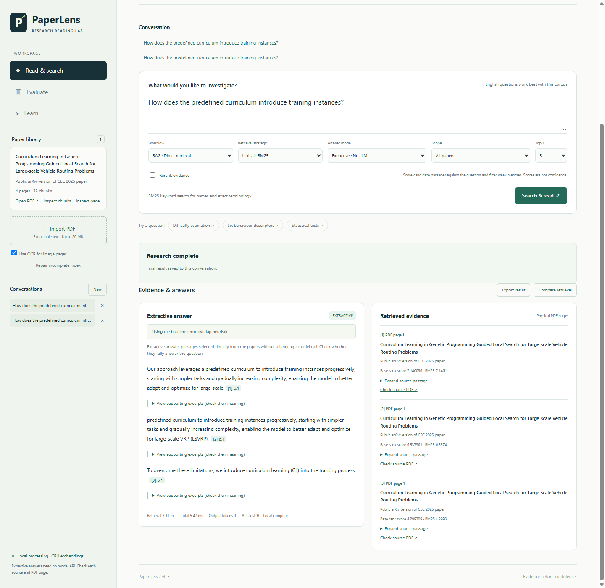

# PaperLens

Help a reader ask questions across local research PDFs and inspect the original passages behind the answer.

## The reading problem and the goal

Finding an answer across several papers involves locating a relevant passage and checking its context. An answer without a traceable source adds another verification task. Exact keyword search alone also does not cover every way a reader might phrase a question.

PaperLens aims to **bring question answering and source-page inspection into one local reading workflow**. The intended outcome is a verifiable evidence trail: a question leads to retrieved passages, an answer and identifiable physical PDF pages. Faster reading and more accurate answers are benefits to evaluate, rather than established outcomes.

## How the approach addresses the problem

1. **Preserve the source:** PDF extraction creates page-linked text chunks so a retrieved passage can lead back to its physical PDF page.
2. **Retrieve by terms and meaning:** BM25 handles term matching; local embeddings support semantic matching. Reciprocal-rank fusion combines rankings without treating their different raw scores as interchangeable. Optional reranking refines the candidates.
3. **Separate retrieval from generation:** extractive mode returns source text without an LLM. Optional local Qwen generation composes an answer from evidence; the agent workflow can use bounded search and page-reading tools.
4. **Make checking possible:** the FastAPI interface and SQLite storage retain the document/conversation context, while labelled cases and regression tests support inspection of retrieval and source-handling behaviour.

## What has been demonstrated

The local prototype implements the retrieval, answer-mode and source-reference workflow. In the 23 November 2026 review, the API and browser interface started successfully and **42 core tests passed**, covering retrieval scoring, source checks, API behaviour, conversations and other core logic.



*A real query against one public paper, using lexical BM25 retrieval and extractive answers with reranking disabled. Three returned passages were checked against physical PDF page 1; no language model was called. See the [demonstration conditions](docs/DEMONSTRATION.md). This single example is not an accuracy benchmark.*

Evidence: [retrieval implementation](paperlens/retrieval.py), [source checks](paperlens/grounding.py), [tests](tests/) and [evaluation cases and interpretation](evaluation/README.md).

## What still needs evaluation

Those core checks are not a full model-based benchmark. This review did not rerun the complete model/OCR setup, semantic retrieval evaluation or local-LLM generation. The supplied labelled cases are a small development set. A stronger result would report retrieval relevance and citation correctness on held-out questions, plus task time and failures under a stated corpus and configuration.

PaperLens uses pretrained models; it does not train a foundation model. Source checks can fail, and readers still need to inspect the PDF. It is intended for local use.

**Implementation:** Python · FastAPI · SQLite · BM25 · Hybrid retrieval · RAG · Local LLMs

[中文使用说明](README.zh-CN.md) · [Learning guide](docs/LEARNING_GUIDE.zh-CN.md) · [Agent walkthrough](docs/AGENT_GUIDE.zh-CN.md)

## Start on Windows

1. Open `Start.cmd`. First use prepares a separate Python environment and retrieval model, requiring an internet connection.
2. Open `http://127.0.0.1:8765`, import a PDF and start with **Extractive · No LLM**.
3. Inspect the cited page for a question whose answer you already know.
4. Use `Setup-AI.cmd` to prepare optional local generation, then restart.
5. Use `Stop.cmd` to stop the service.

Environment files and model downloads belong under `%LOCALAPPDATA%\PaperLens`, outside the source directory. Imported PDFs, the index and conversations are local runtime data; they are not included in this repository. CPU generation speed depends on the machine and model.

## Repository guide

| Location | Responsibility |
|---|---|
| `paperlens/` | Ingestion, retrieval, generation, source checks, storage and API |
| `web/` | Browser interface |
| `scripts/` | Model preparation and sample-document utilities |
| `tests/` | API, retrieval, grounding and conversation regression checks |
| `evaluation/` | Labelled retrieval cases |
| `evaluate.py` | Evaluation entry point |
| `docs/` | Usage and learning documentation |
| Root `.cmd` / `.ps1` files | Windows setup and launch entry points |

## Evaluation

With project dependencies and development tools installed:

```bash
python -m pip install pytest
python -m pytest -q tests/test_retrieval.py tests/test_grounding.py tests/test_evaluate.py
python evaluate.py --labels evaluation/eval_cases.json
```

The evaluation command also needs the matching papers indexed and the retrieval/reranking models available. See [evaluation scope](evaluation/README.md) before interpreting its output.
