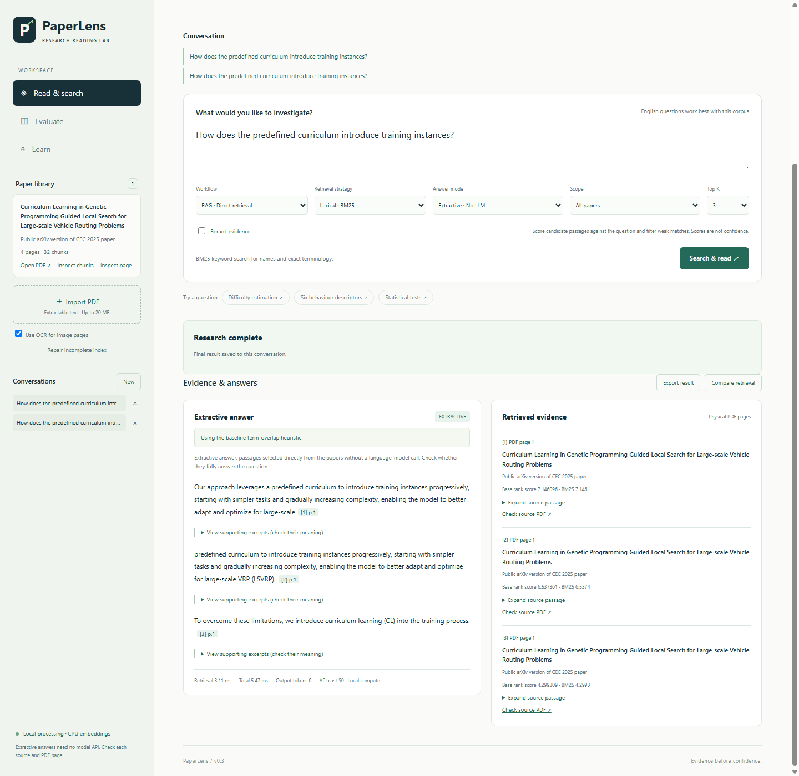

# Public-paper demonstration

On 23 November 2026, the existing ingestion module indexed the fixed public PDF [arXiv:2505.15839v1](https://arxiv.org/abs/2505.15839v1), *Curriculum Learning in Genetic Programming Guided Local Search for Large-scale Vehicle Routing Problems* by Saining Liu, Yi Mei and Mengjie Zhang.

The isolated library contained one four-page document and 32 text chunks. The actual API and browser interface were used to ask: **How does the predefined curriculum introduce training instances?**

Settings: lexical BM25 retrieval; extractive answer; reranking off; top K = 3. The three returned passages came from physical PDF page 1. Each returned passage was checked against the extracted text of that source page. The interface displayed the answer excerpts alongside source links.

This demonstrates ingestion-module output, retrieval, the API, the interface and page traceability for one question. It does not test semantic embeddings, OCR, local-LLM generation, general answer correctness or time savings. The two overlapping excerpts visible in the result should not be counted as independent corroboration. The PDF and runtime database are not bundled with the repository; use the source link above.

PDF SHA-256: `9765220b99ed60185873f98627cb50c80436918804fd7f40b1572a4d055c765c`.
