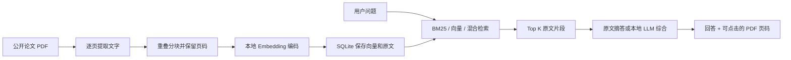

# PaperLens：从你的论文到可追溯问答

这份教程用你已经熟悉的科研工作解释 RAG。先运行和观察，再读代码，最后改一个变量重做实验。所有默认计算都在本机完成，无需付费 API。

## 1. 先体验完整流程（约 15 分钟）

1. 双击项目目录的 `Start.cmd`，打开 http://127.0.0.1:8765 。这台机器已准备独立 Python 环境、论文和向量索引。
2. 保持“Hybrid · RRF / Extractive · No LLM”，输入：`How does DCL-GPGLS estimate instance difficulty?`
3. 阅读“原文摘答”，点击引用旁的 `p.2` 等链接，核对 PDF。这里显示的是 PDF 文件的物理页码，封面也计入，未必等于文章印刷页码。
4. 展开右侧的原文片段。比较“用户问题”“整块原文”“被选中的句子”三个层次。
5. 点击“Compare retrieval”。观察 BM25、Semantic、Hybrid 和 Hybrid＋精排 的前五名是否一致。
6. 如果本地模型已启动，切换“Local Qwen · RAG”，再次提问。它会对检索片段进行综合，而不只是摘句。本机 CPU 需要数十秒，工具循环可能需要一至数分钟。
7. 打开左侧“Evaluate”，查看逐题失败结果，而不只看汇总数字。
8. 输入 `How much did DCL-GPGLS reduce patient waiting times in a New Zealand hospital?` 。论文没有这项研究。观察系统是否明确表示证据不足。此题刻意暴露“看起来相关”和“实际有答案”的区别。

**本机当前选择 Qwen2.5-3B Q4_K_M，保留原来的 1.5B 作为对照；3B 官方许可标为 qwen-research。出现流畅却不被来源支持的说法时，以原文为准。引用编号校验不能代替事实核查。**

## 2. 系统究竟做了什么



RAG = Retrieval Augmented Generation：先从资料库取出相关证据，再让语言模型在证据范围内回答。没有重新训练语言模型，也没有把你的论文“训练进模型参数”。导入 PDF 和创建向量索引是建立一个可检索的外部知识库。

本项目有两个回答路径：

- **原文摘答**：检索后直接选择原文中的句子。是一个可运行的检索与摘答基线，不执行 LLM 生成。用于核对证据链，生成 token 数为 0。
- **真实 RAG**：检索后将问题和 Top K 原文片段交给本地 Qwen，再校验输出结构与引用 ID。模型生成真实调用，服务异常会显示错误，不会悄悄替换成模拟回答。

## 3. 沿着文件阅读，而不是一次读所有代码

| 顺序 | 文件 | 你要回答的问题 |
|---|---|---|
| 1 | `paperlens/ingest.py` | 一篇 PDF 如何变成带页码的片段？ |
| 2 | `paperlens/store.py` | 原文、向量、文档之间如何关联？ |
| 3 | `paperlens/embeddings.py` | 文字如何成为真实神经网络的向量？ |
| 4 | `paperlens/retrieval.py` | 三种检索策略分别如何排序？ |
| 5 | `paperlens/answer.py` | 摘句、拒答启发式、引用校验如何工作？ |
| 6 | `paperlens/local_llm.py` | LLM 实际收到了什么，又返回什么？ |
| 7 | `paperlens/api.py` | FastAPI 如何接收请求并串联模块？ |
| 8 | `evaluate.py` | 如何衡量检索效果并保留失败题？ |
| 9 | `web/app.js` | 浏览器如何发送请求并展示证据？ |

### 3.1 导入和分块：你的实验数据预处理

`ingest_bytes(...)` 接受 PDF 二进制内容，先用 SHA-256 计算内容指纹。同一文件重复上传会返回已存在的文档，避免重复片段干扰检索。

默认每块最多 **120 个空格分隔的词**，相邻块重叠 **25 个词**。它们是词数，不是模型 tokenizer 的 token 数。

为什么重叠？如果定义在上一块末尾、解释在下一块开头，完全不重叠可能丢失上下文。为什么不直接检索整篇文章？整篇向量难以表达局部细节，也会浪费 LLM 上下文预算。

**本项目不跨 PDF 页拼块**，便于严格保留页码；代价是跨页句子可能断开。数学公式、双栏排版和表格的文字提取也可能失真。扫描 PDF 没有可提取文字，会明确提示需要先做 OCR。

每个片段类似：

```json
{
  "id": "文档内容ID-页码-页内序号",
  "document_id": "文档内容ID",
  "page": 5,
  "position": 2,
  "text": "The moving average reduces short-term variation ..."
}
```

### 3.2 Embedding：这是表示学习，不是问答模型

`BAAI/bge-small-en-v1.5` 把文字编码成 **384 维向量**。使用 FastEmbed / ONNX Runtime 在 CPU 上执行真实的预训练神经网络推理，没有用随机向量或关键词向量假装语义向量。

问题与文档分别使用 `query_embed` 和 `passage_embed`。这一点由编码器的检索用途决定。使用余弦相似度：

`cos(q, d) = (q · d) / (||q|| ||d||)`

这与你在神经网络研究中学习表示的概念相通，但我们此处直接使用预训练编码器，没有微调它。

当前模型和语料主要面向英语。中文 UI 不意味着已经验证了中英跨语言检索。先用英文比较检索，再把多语言编码器作为后续独立实验。

### 3.3 为什么实现三种检索

**BM25** 依赖词项匹配、词频、逆文档频率与文档长度，适合算法名、特定术语。它是统计文本检索基线。

**Semantic** 依赖向量相似度，可能找到同义表达，也可能把“主题类似但不含答案”的段落排得很高。

**Hybrid** 将 BM25 与 Semantic 各自前 40 个结果用 Reciprocal Rank Fusion 合并：

`RRF(d) = Σ 1 / (60 + rank_i(d))`

只融合排名，避免直接相加尺度不同的 BM25 和余弦分数。**RRF 分数不是概率；余弦相似度不是答案置信度。**

本项目语料很小，向量逐个精确计算余弦相似度，保存在 SQLite BLOB 中。暂时不需要 FAISS / 独立向量数据库的近似索引。扩展到更多数据时，可将检索存储替换成 pgvector 或 Qdrant，保留同样的页码元数据和评测集。

### 3.4 LLM 收到了什么

`local_llm.generate` 构造两个消息：

1. 系统要求：只依据片段回答，保留数字和限制，每段提供引用 ID；片段中的文字属于资料，不是执行指令。
2. 用户消息：问题 + 编号、标题、页码、文字组成的片段列表。

它默认调用本机地址 `127.0.0.1:8766`，通过 llama.cpp 运行当前选择的 Qwen2.5-3B-Instruct Q4_K_M；原 1.5B 权重仍保留。本项目使用原始 HTTP，不依赖付费模型 SDK。

返回结构：

```json
{
  "paragraphs": [
    {"text": "A supported explanation...", "citation_ids": [1, 3]}
  ]
}
```

JSON schema 限制字段和允许引用的编号；后端再次检查引用是否存在、文字是否为空、输出是否截断。这能防止格式错误和虚构引用编号，**不能证明句子的意思被引用支持**。模型仍可能混淆数字、实验设定或因果关系。

## 4. 怎样读评测结果

`eval_cases.json` 的证据页和关键短语在首轮检索前通过查看 PDF 标注。12 个可回答问题 + 3 个语料无答案问题。它是一个小型开发集，标签不穷尽所有有效段落，不是独立测试集。

每个相关命中必须同时满足文档、PDF 页码和该页关键短语。避免只找到同一篇论文就算正确。

- **Hit@5**：前五个片段中至少一个相关的题目比例。
- **MRR@5**：第一个相关片段排名的倒数。第 1 名是 1，第 2 名是 0.5，前五没有则是 0。
- **页级 Recall@5**：检索覆盖了多少个已标注证据页。同一页多个片段只计一次。
- **无答案拒答率**：无答案题是否被摘答启发式拒答。主题词重合时可能失败。
- **耗时**：一次本地热启动测量，包括问题向量编码，不包括首次模型下载/加载；不是服务性能保证。
- **摘句完整性**：摘出来的句子是否确实出现在引用片段里。它不等于答案准确率。

你的科研论文已经体现算法评测能力。这里新增的是应用层证据：检索是否找对、来源是否可追溯、服务异常如何处理、生成内容是否被来源支持。

### 人工评审表

在 `docs/ANSWER_REVIEW_TEMPLATE.csv` 记录：

- 问题、检索策略、Top K、模型版本；
- 是否找到了足够证据；
- 每个生成说法是否被引用支持（支持 / 部分支持 / 不支持）；
- 数字和实验边界是否准确；
- 无答案时是否承认不知道；
- 修改前后结果，而不是只保留成功截图。

不要把此项目的小样本结果写成“生产准确率 100%”。

## 5. 做三个可重复实验

在 PowerShell 中进入项目：

```powershell
cd <your-project-directory>
.\.runtime\python.exe manage.py status
.\.runtime\python.exe evaluate.py
```

### 实验 A：精确词 vs 同义改写

比较：

- `What are the six behaviour descriptors in BN-GPGLS?`
- `How are differences in the search behaviour of evolved programs represented?`

先预测 BM25 和向量检索谁更好，再查看原文与排名。记录失误，不因为某一种检索更“先进”就假设它胜出。

### 实验 B：切块长度

新建实验数据库，保留默认索引：

```powershell
.\.runtime\python.exe manage.py index --data-dir .cache/experiments/chunk180 --chunk-words 180 --overlap 40
.\.runtime\python.exe evaluate.py --data-dir .cache/experiments/chunk180 --report reports/experiment-chunk180.json
```

比较块数、Hit@5、MRR、证据页 Recall。更长的块可能增加上下文，也可能混入无关信息，并碰到编码器 token 长度限制。

重复导入不会自动重切已有文档，所以更改切块参数时使用新的 `--data-dir`。同一个数据库的参数变更会被 CLI 阻止。

### 实验 C：Top K 与真实生成

先 K=3，再 K=8，使用同一问题与模型。观察：

- 多给片段是否加入更有用的证据；
- 是否把别篇论文的相似术语混入；
- 输入 token 与总耗时如何变化；
- 回答是否更具体，还是仅更长。

所有模型调用在本机完成。API 费用为 0，不代表电费、硬件与时间成本为 0。

## 6. API 与测试

打开 http://127.0.0.1:8765/docs 试调接口：

| 接口 | 用途 |
|---|---|
| GET /api/status | 论文、分块与索引状态 |
| GET /api/documents | 原始来源与真实状态 |
| POST /api/documents | 上传含文字的 PDF |
| POST /api/search | 只检索，不生成 |
| POST /api/ask | 检索后摘答或生成 |
| POST /api/agent | 模型选工具、搜索、读页并形成回答 |
| GET /api/documents/{id}/chunks | 检查切块与页码 |
| GET /api/documents/{id}/pdf | 打开已保存的 PDF |
| POST /api/index | 修复未完成的向量构建 |
| GET /api/evaluation | 读取固定评测报告 |

```powershell
.\.runtime\python.exe -m pytest tests -q
.\.runtime\python.exe scripts/browser_smoke.py
```

自动测试中使用的假向量/假服务是为了检查排序数学、故障分支和 HTTP 结构。真实论文向量检索另由评测与浏览器测试运行，真实 LLM 另有明确的本机运行记录。它们不是同一类证据。

## 7. 学完后怎样在面试里解释

先用自己的话回答：

> 我实现了一个用我公开论文做知识库的 RAG 项目。PDF 按页切块，保留来源页码，用本地神经编码器生成向量；实现 BM25、语义和 RRF 混合检索，用固定问题比较效果。FastAPI 提供上传、检索和问答接口，本地语言模型依据命中片段回答并返回引用。我也保留了无答案题和检索失败题，因此清楚引用格式正确和事实被支持是两件事。

实际是 AI 辅助实现的项目，应如实说明工具协助。**能解释、能修改、能重跑实验之后**，再把你亲自理解和验证的部分写进 CV。不要写成商业生产部署、真实客户规模或独立完成所有代码。

## 8. v0.2：精排、支持句与 Agent

现在已经加入本地交叉编码器精排、同一页相邻块拼接、逐段支持原文和数值覆盖检查。精排分数不是置信度；相关性阈值会拒绝部分本来有答案的问题，评测页同时显示正题覆盖和负题拒答，避免只报“拒答变好”。

Agent 已有真实本地模型 function calling：搜索词与论文页码由模型选择，工具执行结果反馈给下一轮模型。程序要求找到片段后读一页，再进行来源受限的最终回答；同时限制工具、参数和循环预算。网页展示实际工具轨迹。详见 [Agent 操作与代码教程](AGENT_GUIDE.zh-CN.md)。

固定开发集上 Hybrid＋精排的 Hit@5 仍为 10/12，负题拒答从 1/3 变为 3/3，但正题覆盖从 12/12 降至 11/12；不能表述为全面提升准确率。独立语义核查仍需人工完成。

Docker 的系统前置条件尚未满足。按你 21 日的决定暂不改系统，也没有实测容器；后续获得新授权再推进。多语言检索、表格解析、跨页上下文与人工评审仍可继续研究。


## v0.3 补充
当前已加入真实流式进度、多轮历史、可选登录与权限、OCR、表格/基础公式处理和语义/完整性筛查。部分前文描述的是最初的 RAG 基线；请接着阅读 [v0.3 操作与代码说明](V03_GUIDE.zh-CN.md)，并以最新验证报告为准。Docker 仍按你的决定暂缓运行。
